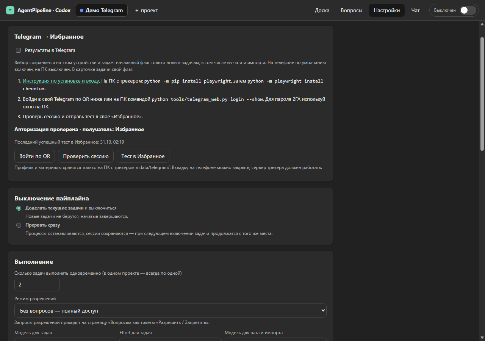
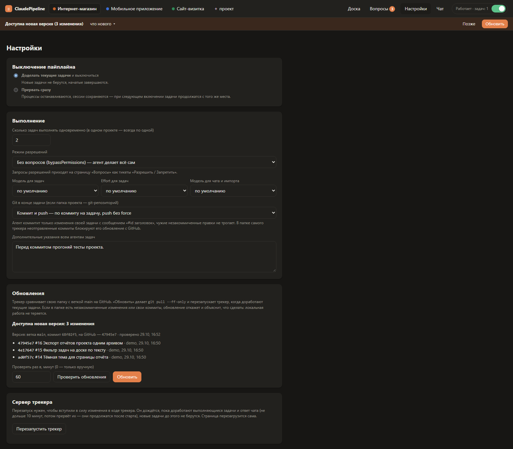
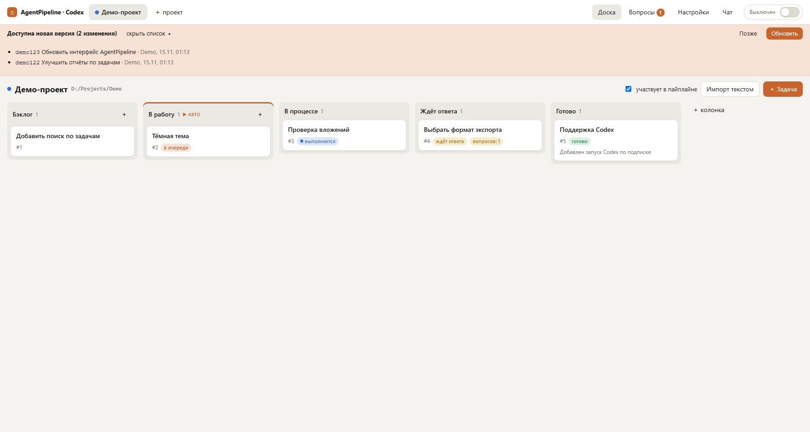

# AgentPipeline

Личный канбан-трекер: задачи выполняет Claude Code или Codex по подписке, без API-ключа.

Заводишь задачи на доске, переносишь в «В работу» и включаешь переключатель. Дальше трекер сам запускает на каждую задачу отдельную сессию выбранного исполнителя в папке проекта. Агент отмечает прогресс, задаёт вопросы, если без тебя не обойтись, коммитит свои изменения и в конце пишет отчёт. Всё работает локально: сервер на Python без внешних зависимостей, интерфейс в браузере.


## Возможности

- **Доска на каждый проект**: Бэклог → В работу → В процессе → Ждёт ответа → Готово плюс свои колонки, карточки перетаскиваются мышью.
- **Автоматическое выполнение**: у каждой задачи своя сессия выбранного агента, в одном проекте задачи идут по очереди, разные проекты работают параллельно.
- **Вопросы агентов**: когда нужно твоё решение, задача ждёт ответа, а после него продолжает ту же сессию.
- **Отчёты**: краткий итог в карточке и подробный markdown-отчёт по каждой задаче.
- **Результаты в Telegram**: по желанию итог и материалы приходят в «Избранное», с отдельным выбором для устройства и задачи.
- **Связанные задачи**: агент получает итоги и отчёты задач, от которых зависит его работа.
- **Чаты с выбранным агентом** в каждом проекте: сколько угодно чатов с автоназваниями, файлами и скриншотами. Агент в чате видит доску и умеет ею управлять.
- **Импорт текстом**: кусок из Jira, письма или заметок превращается в карточки.
- **Коммит на задачу**: агент коммитит только свои изменения и по желанию делает push.
- **Лимиты подписки**: упёрлись в лимит — пауза до сброса, потом работа продолжается сама.
- **Перезапуск и обновление с GitHub**: одной кнопкой и без потери текущей работы.

## Требования

- Windows 10/11.
- Python 3.10+ (должен вызываться как `python`).
- Один из исполнителей: **Codex CLI** (см. раздел «Запуск с Codex») либо [Claude Code](https://docs.claude.com/en/docs/claude-code), в котором выполнен вход по подписке (Pro/Max): команда `claude` запускается из терминала и не просит войти. API-ключ не нужен.
- Git, если нужны обновление трекера с GitHub и коммиты по задачам.

Для базового трекера больше ничего ставить не надо: ни pip, ни npm. Только для опциональной [доставки в Telegram](#результаты-в-telegram) отдельно устанавливаются Playwright и Chromium.

Git и GitHub необязательны для обычной работы трекера: можно скачать ZIP через GitHub → Code → Download ZIP, распаковать и запустить нужный `.cmd`. В настройках выбери `git_mode=off`, если коммиты не нужны. Установка из ZIP не поддерживает обновление кнопкой через Git.

## Установка и запуск

```
git clone https://github.com/makisima3/AgentPipeline.git
cd AgentPipeline
start_claude.cmd
rem Или для Codex:
start_codex.cmd
```

`start_claude.cmd` выбирает Claude, `start_codex.cmd` — Codex. Скрипт запускает `python server\main.py` в окне консоли «AgentPipeline» и открывает в браузере http://127.0.0.1:8765. При первом запуске создаётся пустая база `data/tracker.db`. Сервер слушает только `127.0.0.1`, снаружи он недоступен.

- Другой порт: `set PIPELINE_PORT=8800` перед `start_claude.cmd`.
- Без автооткрытия браузера: `start_claude.cmd --no-browser`.
- Остановить: Ctrl+C в окне сервера. Выполняющиеся задачи прерываются и продолжатся с того же места после следующего запуска, если пайплайн включён.

**Что можно закрывать.** Вкладку браузера — можно: вся работа идёт в сервере, задачи выполняются и без открытой страницы, вернуться можно в любой момент по тому же адресу. Вкладок можно держать сколько угодно. **Окно консоли сервера закрывать нельзя**: это и есть трекер, вместе с ним остановятся все агенты. Его можно свернуть. После перезапуска или обновления трекер продолжает работу в новом свёрнутом окне с тем же названием, его тоже не закрывай.

## Запуск с Codex

Нужны Python 3.10+ и **Codex CLI 0.166.0 или новее**, доступный командой `codex`. Выполни `codex login` и войди через ChatGPT с доступом к Codex. Одного расширения редактора или приложения без доступной команды CLI недостаточно. [Установка CLI](https://learn.chatgpt.com/docs/codex/cli), [авторизация](https://learn.chatgpt.com/docs/auth).

После этого достаточно скачать репозиторий и запустить `start_codex.cmd`. `app-server` входит в Codex CLI: трекер автоматически запускает его по stdio. API-ключ, Docker, pip-пакеты, сборка фронтенда и ручная настройка сервера не нужны. При отсутствии CLI, подходящей версии или входа в консоли будет объяснение. На старте проверяются авторизация ChatGPT и доступный каталог моделей; настройки API-провайдера для запусков трекера заменяются на OpenAI/ChatGPT.

Оба варианта используют одну доску. Перед сменой исполнителя закрой предыдущий трекер: второй сервер на этой базе не запустится даже на другом порту. Для прямого запуска: `python server/main.py --agent codex` (или `--agent claude`). Выбор сохраняется при встроенном перезапуске и обновлении.

Сессии и настройки моделей, effort, разрешений и паузы по лимиту разделены. Старые сессии и настройки остаются за Claude. При смене исполнителя агент получает доступный контекст задачи или историю чата; идентификаторы сессий между исполнителями не передаются. Вернувшись к исполнителю, можно продолжить его собственную сессию с актуальным контекстом. «Сбросить сессию» сбрасывает только сессию выбранного исполнителя. История, вложения, связи и отчёты сохраняются; база мигрирует автоматически.

В режиме Codex список моделей берётся из CLI. В режиме без вопросов даётся полный доступ; остальные режимы используют workspace-write или read-only и показывают запросы разрешений на странице «Вопросы». Их границы определяет sandbox Codex, поэтому состав запросов может отличаться от Claude. При неизвестном времени сброса лимита интерфейс показывает время **повторной попытки**, а не обещает сброс лимита. Стоимость API для Codex не вычисляется.

## Существующий клон

Если в старом клоне трекера остался адрес до переименования, обнови его для получения обновлений (свой настроенный форк/remote без необходимости не меняй):

```text
git remote set-url origin https://github.com/makisima3/AgentPipeline.git
```

Локальная папка может называться произвольно; при её переносе сохраняй папку `data/` целиком. Переименование интерфейса и репозитория не меняет формат базы, отчётов и сессий.

## Быстрый старт

1. **Создай проект**: «＋ проект» в шапке → название и папка, в которой агент будет работать («Обзор…» открывает выбор папки). Claude подхватывает `CLAUDE.md`, Codex — `AGENTS.md` из папки проекта.
2. **Заведи задачи**: «＋ Задача», «＋» в колонке, через чат («заведи задачи: …») или «Импорт текстом». В описании напиши контекст, что сделать и критерии готовности.
3. **Перенеси их в «В работу»**: перетаскиванием или кнопкой «В работу» в карточке.
4. **Включи переключатель** в правом верхнем углу. Задачи начнут выполняться, ход работы виден в карточке в реальном времени.
5. **Отвечай на вопросы** (счётчик рядом с «Вопросы») и **читай отчёты** в «Готово».

## Как пользоваться

### Проекты и доска

У каждого проекта своя папка и своя доска, проекты переключаются в шапке. Колонки по умолчанию:

- **Бэклог** — всё, что ещё не нужно делать;
- **В работу** (▶ авто) — очередь: отсюда задачи берутся сверху вниз, порядок меняется перетаскиванием;
- **В процессе** — выполняется сейчас;
- **Ждёт ответа** — агент задал вопрос;
- **Готово** — с итогом в карточке.

Свои колонки добавляются кнопкой «＋ колонка», переименовываются и удаляются через ⋯ (задачи удалённой колонки уходят в бэклог). Галочка «участвует в пайплайне» над доской временно исключает проект из выполнения. Название, папка, цвет и удаление проекта — в «Настройках»; при удалении проекта файлы в его папке не трогаются.

### Выполнение задач

Пока переключатель в шапке включён, трекер берёт задачи из «В работу»: в одном проекте по одной, всего не больше N одновременно (N задаётся в настройках). На каждую задачу запускается отдельная сессия выбранного исполнителя в папке проекта, контекст у задач не смешивается. Рядом с переключателем написано, что происходит: «Работает · задач: 1», «Пауза по лимиту до 18:00», «Доделывает и выключится».

Выключение работает в одном из двух режимов (выбирается в настройках):

- «доделать текущие» — начатые задачи завершаются, новые не берутся;
- «прервать сразу» — процессы останавливаются, при следующем включении задачи продолжатся с того же места.

### Карточка задачи


В карточке:

- заголовок, описание, модель и effort (по умолчанию берутся из настроек); номера вида `#12` из описания выводятся строкой «Упомянуты» и открывают карточку;
- статус, примерная стоимость в эквиваленте API (по подписке за неё не платишь) и id сессии; полный id — в подсказке;
- итог и ссылка «подробный отчёт»;
- связанные задачи;
- «Ход работы» в реальном времени: заметки агента, вызовы инструментов, вопросы, ответы, твои комментарии;
- комментарий: агент увидит его при следующем запуске;
- кнопки: «Остановить» (задача уходит в бэклог, сессия сохраняется), «Продолжить / вернуть в работу», «Сбросить сессию» (следующий запуск начнётся с чистого листа), «Сырой лог» (stream-json всех запусков, первая строка каждого — промпт, который получил агент).

Если запуск закончился ошибкой, она показана в карточке и на доске, а повторить задачу можно той же кнопкой «В работу». Чтобы доработать готовую задачу, напиши комментарий и нажми «Продолжить / вернуть в работу»: агент продолжит ту же сессию с актуальными заголовком, описанием и новыми комментариями. Любую сессию можно продолжить и вручную: `claude --resume <id сессии>` или `codex resume <id сессии>` в папке проекта.

### Отчёты


В конце задачи агент пишет краткий итог для карточки и подробный отчёт: что сделано, изменённые файлы, как проверить, принятые решения, открытые вопросы. Отчёт открывается отдельной страницей `/report/<id>` и лежит в `data/reports/task-<id>.md`. При повторном запуске новый отчёт пишется сверху, а прошлый сворачивается под ним. Если агент закончил, не написав отчёта, отчётом становится его последний ответ.

### Результаты в Telegram



Опциональная интеграция присылает краткий итог и подготовленные агентом файлы в **«Избранное» вашего аккаунта** через Telegram Web. Удобно, когда ставишь задачи с телефона: вкладку можно закрыть, доставку выполняет сервер после завершения агента. ПК и сервер трекера должны оставаться включёнными. Бот, `api_id` и API-ключи не нужны; базовая работа трекера не требует Telegram или Playwright.

**Подключение для новой установки:**

1. На ПК с трекером открой терминал в папке скачанного репозитория. Тем же Python, которым запускается трекер, установи дополнительные компоненты:

   ```text
   python -m pip install playwright
   python -m playwright install chromium
   ```

2. В трекере открой **Настройки → Telegram**. Прочитай инструкцию и нажми **Войти по QR**. В Telegram на телефоне: **Настройки → Устройства → Подключить устройство**, отсканируй QR на экране ПК. Вход ожидается до пяти минут, QR обновляется автоматически.
3. Если нужен пароль двухэтапной проверки или вход по номеру, нажми **Отменить вход** и выполни `python tools/telegram_web.py login --show` на ПК. Войди в открывшемся отдельном Chromium, затем нажми **Проверить сессию** в трекере. Профиль обычного Chrome/Edge не используется. При открытом ручном входе не запускай вторую операцию с тем же профилем.
4. Дождись **Авторизация проверена · получатель: Избранное**, нажми **Тест в Избранное** и проверь сообщение у себя. Интерфейс показывает время последнего успешного теста. Наличие папки профиля не считается авторизацией.

**Какие задачи отправляются:**

- **Результаты в Telegram** над доской, у поля чата и в настройках — выбор этого устройства/браузера. На новом телефоне или планшете по умолчанию включён, на ПК выключен. Источник определяется интерфейсом по признакам мобильного браузера, а не окружением агента или шириной окна. Ручной выбор запоминается в localStorage для адреса трекера.
- При создании задачи это начальное значение записывается в её отдельный флаг **Отправить результат в Telegram**. В карточке его можно менять независимо от общего переключателя и устройства просмотра. Чат и импорт тоже передают настройку устройства; перед импортом флаг можно уточнить для каждой задачи. Общий переключатель **не подписывает старые задачи**.
- Явная просьба «скинь результат в ТГ» включает отправку для конкретной задачи даже при выключенном общем выборе. Простые просьбы из формы распознаются сразу, агент чата передаёт намерение через `telegram_notify` в `create_task`/`update_task`, агент задачи — при завершении. Если вручную включить флаг старой завершённой задачи без доставки, отправится сохранённый итог; за новыми материалами её нужно вернуть в работу. Повторное включение уже доставленного результата не создаёт нового сообщения.

До настройки аккаунта переключатель предлагает подключение. Флаг можно сохранить заранее; если задача завершится до входа, её доставка покажет отдельную ошибку и будет доступна для повтора.

**Формат результата:** кратко, что сделано и что действительно проверено, с материалами, по которым понятен результат. Пройденные тесты упоминаются только после их реального успешного запуска. Для визуальных изменений, особенно игровых, агент готовит скриншоты; короткое видео — если нужно показать движение/взаимодействие и его реально можно записать. Сначала приходит текст, затем файлы как документы с подписями. Полный отчёт остаётся в трекере. Лимиты: около 3500 символов текста с заголовком, до 10 вложений, до 100 МБ на файл и 300 МБ всего. Агент передаёт текст и пути в `finish_task`; трекер копирует материалы до его выхода и отправляет централизованно.

**Если доставка не удалась:** задача остаётся выполненной, её карточка отдельно показывает ошибку Telegram и кнопку **Повторить доставку**. Уже подтверждённые части повторно не отправляются. При потере сессии открой настройки, войди заново, проверь сессию и повтори нужную доставку. После перезапуска ранее настроенная сессия проверяется снова. При сбое в момент отправки появится **Нужно проверить Избранное**: найди часть с указанной меткой `[AP:…]` и выбери «Последняя часть получена» или «Её нет — повторить». Автоматически дублировать неоднозначную отправку трекер не будет. Для отсутствующего/слишком большого исходного файла нужно вернуть задачу агенту на подготовку материалов.

Авторизация, очередь и материалы хранятся локально в `data/`, исключённой из git. Другу передавай чистый код репозитория: он подключает свой аккаунт по этим же шагам. Только «Избранное», без личных алиасов и абсолютных путей владельца. Подробности и короткая инструкция агенту — [docs/telegram-results.md](docs/telegram-results.md).

### Связанные задачи

Задачу можно связать с другими, нужными ей для контекста: например, «Скидки по промокодам» с «Корзина: пересчёт». В карточке блок «Связанные задачи» → поиск по номеру или части заголовка, убрать связь — ✕. Чат тоже умеет связывать: «заведи задачу …, свяжи с #4».

- Связь двусторонняя: видна в обеих карточках, на доске у карточки значок 🔗 с числом связей.
- Связывать можно и задачи разных проектов, тогда в карточке указан проект.
- В промпт задачи (и при каждом повторном запуске) добавляется раздел «Связанные задачи»: заголовок, колонка, статус, итог и путь к отчёту, который агент может прочитать сам.
- Номера вида `#12` в описании, ходе работы, комментариях и чате кликабельны.

### Вопросы агентов


Когда агенту нужно твоё решение, он задаёт вопрос (иногда с вариантами ответа) и завершает ход: задача уходит в «Ждёт ответа», токены не тратятся, остальные задачи и проекты продолжают работать. Вопросы всех проектов собраны на странице «Вопросы», их число — на значке в шапке. Ответить можно там, в карточке задачи или через чат, вариантом или своим текстом. После ответа задача возвращается в очередь и продолжает ту же сессию.

Если в настройках выбран режим разрешений, отличный от «без вопросов», сюда же приходят запросы прав («Разрешить / Запретить») с подробностями действия.

### Чаты


Панель справа («Чат» в шапке) — выбранный агент с доступом к трекеру. Он заводит, правит, связывает и переносит задачи, рассказывает про статус и вопросы, отвечает на вопрос агента, если ты дал ответ, включает и выключает пайплайн. Можно вставить кусок текста — он разберёт его на задачи.

- **Несколько чатов.** «Новый» начинает чистый чат, старые остаются в списке под названием в шапке панели (▾). В списке у каждого чата дата последнего сообщения и число сообщений. У каждого чата свои сессии Claude и Codex, так что в любой можно вернуться и продолжить разговор. Трекер помнит последний открытый чат проекта.
- **Одновременные ответы.** Разные чаты могут отвечать параллельно, в одном чате — один ответ за раз (его можно прервать кнопкой «Стоп»). Если переключиться, пока чат отвечает, ответ допишется в свой чат.
- **Автоназвания.** Название придумывает модель, как у сессий Claude Code: после первого ответа отдельный короткий запрос (Claude — haiku, Codex — выбранная модель чата) даёт название из 2–6 слов. Пока он идёт, чат называется первым сообщением. Если запрос не удался, трекер попробует снова после следующего ответа. ✨ придумывает название заново, ✎ переименовывает вручную (такое название модель больше не трогает), 🗑 удаляет чат вместе с его сообщениями и файлами.
- **Файлы и скриншоты**: скрепкой, перетаскиванием в панель или Ctrl+V для скриншота. До 20 МБ на файл, до 10 файлов и 100 МБ на сообщение. Картинки показываются превью, остальные файлы — ссылками.

### Импорт текстом


«Импорт текстом» над доской: вставь текст из другого трекера, письма или заметок, агент разберёт его на карточки. Перед созданием их можно поправить, снять лишние и выбрать колонку.

### Настройки



- выключение пайплайна: доделать текущие или прервать сразу;
- сколько задач выполнять одновременно;
- режим разрешений: без вопросов (`bypassPermissions`), правки файлов сами, а остальное через «Вопросы», или спрашивать всё, кроме чтения;
- модель и effort для задач, модель для чата и импорта;
- Git в конце задачи (см. ниже);
- Telegram → Избранное: выбор устройства, инструкция подключения, QR-вход, проверка сессии и тест;
- дополнительные указания всем агентам задач, например «Код Unity проверяй через UnityMCP»;
- обновления: интервал проверки, «Проверить обновления», «Обновить»;
- «Перезапустить трекер»;
- название, папка и цвет текущего проекта, удаление проекта.

### Коммиты по задачам

Если папка проекта — git-репозиторий, агент работает по правилу «коммит на задачу». Режим задаётся настройкой «Git в конце задачи» (`git_mode`) и передаётся агенту в промпте:

- **коммит и push** (по умолчанию) — коммит, потом `git push` без force;
- **только коммит** — push делаешь сам;
- **ничего** — агент git не трогает.

В начале агент смотрит `git status`, чтобы отличать чужие незакоммиченные правки от своих. В конце коммитит только изменения своей задачи с сообщением `#<id> <заголовок>` и парой строк о том, что сделано, не связанные между собой изменения — отдельными коммитами. Чужие правки он не трогает и упоминает в отчёте. Если push не прошёл (нет сети, конфликт), агент ничего не обходит — никаких force, rebase и reset — и пишет об этом в отчёте. По умолчанию выбран режим с push: в папке самого трекера неотправленные коммиты блокируют его обновление.

### Git и GitHub: настройка проектов

Режим `git_mode` общий для всех добавленных проектов:

| Режим | Что требуется |
| --- | --- |
| `off` | Git и GitHub-авторизация не нужны; агент не выполняет Git-команды. |
| `commit` | Git, рабочий репозиторий и имя/email автора. Remote и вход в GitHub не нужны. |
| `commit_push` | Всё для коммитов, настроенное направление push и доступ на запись в свой репозиторий или форк. |

В папке без Git-репозитория агент пропускает Git. Репозиторий **самого трекера** нужен для его обновлений, а репозитории **добавленных проектов** — для их кода. Доступ к одному не означает доступ к другим. Даже успешный `gh auth login` не даёт права записи в любой репозиторий; для чужого проекта нужен доступ от владельца или свой форк. В основной репозиторий AgentPipeline пушит только владелец, остальные предлагают изменения через PR из форка.

**1. Установи инструменты, если их ещё нет.** [Git для Windows](https://git-scm.com/install/windows) должен быть доступен командой `git --version`. [GitHub CLI](https://cli.github.com/) (`gh --version`) нужен только для выбранного способа входа через gh. После установки перезапусти трекер, чтобы сервер и агенты увидели новый PATH. Готовые настройки не нужно повторять или заменять.

**2. Проверь автора в терминале папки своего проекта:**

```text
git config --get user.name
git config --get user.email
```

Если значения пусты, задай настоящие имя и email автора (можно использовать GitHub noreply email из настроек аккаунта):

```text
git config user.name "Твоё имя"
git config user.email "твой-email@example.com"
```

Эти команды меняют только текущий репозиторий. Для общего автора всех проектов добавь `--global` после `config`. Имя/email подписывают коммиты и сами по себе не авторизуют push. Подробности: [настройка Git](https://git-scm.com/docs/git-config).

**3. Выбери доступ к хостингу.** Если SSH или HTTPS через менеджер учётных данных уже работает, используй его как есть: устанавливать gh и входить заново не нужно. Для SSH нужен ключ с доступом к нужному аккаунту/репозиторию, загруженный в SSH-agent, если он защищён паролем; первое подтверждение узла проходи сам в терминале. Для HTTPS можно использовать установленный Git Credential Manager и его интерактивный вход. Этот доступ должен работать из той же учётной записи Windows, от которой запущен трекер.

Если хочешь использовать **GitHub CLI для HTTPS**, сам пройди интерактивный вход в терминале:

```text
gh auth login
gh auth setup-git
gh auth status
```

При входе выбери нужный GitHub-хост, HTTPS и предложенный браузерный вход. `gh auth setup-git` подключает gh как менеджер учётных данных для Git; один вход в gh без подключения к Git может быть недостаточен. Для GitHub Enterprise укажи свой узел через `--hostname`. Если используешь SSH, вход gh не заменяет настройку SSH-ключа. Справка: [gh auth login](https://cli.github.com/manual/gh_auth_login), [gh auth setup-git](https://cli.github.com/manual/gh_auth_setup-git). Трекер не запускает эти команды за тебя и не хранит токены/ключи; не добавляй их в URL remote, файлы проекта, чат или отчёт.

**4. Подготовь репозиторий проекта и направление push.** Самый простой вариант — создать свой репозиторий на GitHub (или форк чужого), клонировать его и добавить полученную папку в трекер:

```text
git clone https://github.com/ТВОЙ-АККАУНТ/ТВОЙ-ПРОЕКТ.git
cd ТВОЙ-ПРОЕКТ
```

У обычного клона origin и upstream основной ветки уже настроены. Для папки с существующим кодом можно выполнить `git init -b main`, создать репозиторий на хостинге и подключить remote. Сначала проверь существующие настройки локально; URL могут содержать личные данные, не публикуй этот вывод:

```text
git status
git remote -v
git branch -vv
```

Если remote отсутствует, добавь адрес **своего** репозитория/форка:

```text
git remote add origin https://github.com/ТВОЙ-АККАУНТ/ТВОЙ-ПРОЕКТ.git
```

Для SSH адрес выглядит как `git@github.com:ТВОЙ-АККАУНТ/ТВОЙ-ПРОЕКТ.git`. `git remote set-url origin АДРЕС` используй только если действительно нужно заменить существующее направление. Remote для push может отличаться от fetch: Git учитывает `branch.<ветка>.pushRemote`, затем `remote.pushDefault`, затем remote ветки. Можно сохранить upstream оригинального проекта, а пушить в свой форк.

Обычный `git push` должен знать удалённую ветку. Если она уже существует среди локальных remote-tracking refs, настрой её без отправки изменений (замени `origin/main` своей парой remote/ветка):

```text
git branch --set-upstream-to=origin/main
```

Для нового репозитория/ветки после первого осмысленного коммита можно **самостоятельно отправить реальные изменения** командой `git push -u origin main`. Это уже push, а не проверка: выполняй её, когда готов публиковать код. Ни интерфейс, ни диагностика не делают тестовый push. Если HEAD отсоединён, сначала выбери рабочую ветку через `git switch`. При `push.default=simple` (обычный режим Git) имена текущей ветки и её upstream должны совпадать; особые refspec/mirror и push нескольких веток требуют ручной проверки. Правила: [git push](https://git-scm.com/docs/git-push).

**5. Включи режим и проверь выбранный проект.** В «Настройки» → «Git в конце задачи» выбери «Коммит и push». Автоматически появится проверка Git, репозитория, имени/email, текущей ветки и выбранного направления обычного push. Её можно повторить кнопкой. Способ «Существующий SSH / HTTPS / менеджер учётных данных» не вызывает gh. «GitHub CLI (gh) для HTTPS» дополнительно проверяет статус входа gh для HTTPS-узла выбранного push-адреса. Выбор способа меняет только диагностику в браузере, а не Git-конфигурацию или авторизацию агента.

Проверка читает локальные настройки, не вызывает credential helpers, не обращается к Git-remote, не создаёт коммиты и не меняет конфигурацию; только выбранный статус gh может потребовать сеть. URL, имя/email и сырой вывод команд в UI и логи диагностики не передаются. Сложные настройки или несколько адресов push помечаются для ручной проверки. Это подсказка, а не блокировка работы трекера. Для `commit` доступна отдельная локальная проверка без GitHub, для `off` команды вообще не запускаются.

«Локальные предпосылки настроены» **не гарантирует право записи**. Чтение публичного репозитория и вход gh не доказывают возможность push: могут мешать права, SSO, защита ветки, обязательный PR, серверные hooks, сеть или новые коммиты на сервере. При отказе реального push агент оставляет понятную причину в отчёте, без токенов/ключей; принудительно перезаписывать историю или обходить отказ он не будет. Исправь доступ/выбери разрешённую ветку сам, затем повтори работу. Для обычных задач можно оставить `off` или `commit`.

### Лимиты подписки

Если подписка упёрлась в лимит, задача не падает: она ставится на продолжение, а пайплайн встаёт на паузу до сброса лимита (если время сброса неизвестно — на 15 минут). В шапке видно «Пауза по лимиту до …». После сброса задачи продолжаются сами с того же места. Снять паузу раньше можно в настройках.

### Перезапуск трекера

Перезапуск нужен, чтобы вступили в силу изменения в коде сервера: после обновления или после задачи, которая дорабатывала сам трекер. Его запускает кнопка «Перезапустить трекер» в настройках или сам агент: если задача меняла код трекера, после отчёта он вызывает инструмент `restart_tracker` (то же умеет чат).

Перезапуск отложенный и ничего не теряет:

- трекер перестаёт брать новые задачи, чат перестаёт принимать сообщения;
- он ждёт, пока доработают выполняющиеся задачи и ответы чатов, включая агента, который попросил перезапуск; рядом с переключателем видно, сколько запусков ещё ждём;
- если ждать приходится дольше 10 минут, запуски прерываются и продолжаются после старта;
- новый сервер стартует в своём свёрнутом окне консоли, старое закрывается;
- открытые вкладки показывают «Трекер перезапускается…» и перезагружаются сами.

Журнал перезапусков — `data/restart.log`.

### Обновление с GitHub



Если трекер установлен через `git clone`, он сам проверяет ветку `main` на GitHub: при запуске и потом раз в час (интервал — в «Настройки» → «Обновления», 0 — только вручную; там же кнопка «Проверить обновления»). Когда вышла новая версия, под шапкой появляется плашка «Доступна новая версия» со списком изменений («что нового ▾») и кнопками «Позже» (спрятать до следующей версии) и «Обновить».

«Обновить» делает `git pull --ff-only origin main` и перезапускает трекер по правилам выше: текущие задачи и ответы чатов дорабатывают, страница перезагружается сама, изменения базы применяются при старте. Пока ждём, на плашке написано «Обновлено до …, перезапуск после завершения текущих задач…». Если новый код не компилируется, перезапуск отменяется и работает прежняя версия, а плашка объясняет, что делать.

**Почему «Обновить» может отказать.** Трекер никогда не делает `reset`, `stash` или force, поэтому локальная работа не теряется, но и обновиться поверх неё он не может. Отказ с понятной причиной будет, если:

- в папке трекера есть незакоммиченные изменения (например, их оставил агент, дорабатывавший трекер в режиме без коммита). Покажет список файлов: закоммить или откати их и нажми «Обновить» ещё раз;
- есть свои коммиты, которых нет на GitHub. Отправь их (`git push`) или перенеси поверх новой версии (`git pull --rebase`);
- выбрана не ветка `main`.

Без сети или без доступа к репозиторию трекер работает как обычно, причина тихо видна в настройках. Обновить вручную тоже можно: остановить трекер, выполнить `git pull` и снова запустить `start_claude.cmd`.

Свои доработки трекера держи в ветке или форке, а клон, из которого работаешь, — на чистом `main`: иначе встроенное обновление откажет.

## Безопасность

- **У трекера нет авторизации.** Любой, кто достучится до порта, управляет задачами, а значит и агентами. Сервер слушает только `127.0.0.1` — так и оставь: не меняй адрес на `0.0.0.0`, не пробрасывай порт наружу, не открывай его в файрволе и не публикуй через туннели (ngrok и подобные).
- **Агенты работают с широкими правами.** Каждая задача — это запуск выбранного агента в папке проекта, по умолчанию в режиме `bypassPermissions`: агент сам правит и удаляет файлы, запускает команды и коммитит. Подключай только свои доверенные папки и не давай в работу задачи из непроверенных источников (импорт текстом тоже превращает чужой текст в инструкции агенту). Более осторожные режимы разрешений — в настройках.
- В `data/` лежат база, отчёты, логи запусков и файлы из чатов. Папка в `.gitignore`; не выкладывай её и проверяй логи на личные данные, прежде чем прикладывать к Issue.

## Участие

Баги и идеи — через [Issues](https://github.com/makisima3/AgentPipeline/issues) (есть шаблоны «Баг» и «Предложение по улучшению»). Правки кода — форк, ветка и Pull Request в `main`. Как сообщить о проблеме, соглашения по коду и чек-лист перед PR — в [CONTRIBUTING.md](CONTRIBUTING.md).

## Лицензия

[MIT](LICENSE).

Проверенные сценарии и границы тестирования: [docs/codex-validation.md](docs/codex-validation.md).

## Как устроено

- **Telegram (по желанию)** — `server/telegram.py`: серверная очередь `telegram_deliveries` в SQLite и снимки материалов. `tasks.telegram_notify` общий для Claude/Codex; выбор устройства — только localStorage. `finish_task` принимает `telegram_text`, `telegram_files`, `telegram_notify`, `create_task`/`update_task` — флаг. Доставка ждёт выхода агента, сохраняет прогресс по частям и участвует в отложенном перезапуске. `GET /api/telegram`, `POST /api/telegram/check|login|test|cancel`, `GET /api/telegram/qr|instructions`, `POST /api/tasks/<id>/telegram/retry` — настройка и повтор. `tools/telegram_web.py` запускается отдельным процессом и только там загружает опциональный Playwright.

- **Проверка Git проекта** — `server/git_readiness.py` и `GET /api/projects/<id>/git-readiness?mode=commit_push&auth=existing` (`auth=gh` — по выбору). Независимая диагностика без изменения репозитория; статус `local_ready` относится только к предпосылкам, `write_access=not_checked`. Интерфейс настроек и `App.openGitSettings(projectId)` позволяют открыть эту же проверку из будущего мастера первого запуска.

- **Сервер** — `server/main.py` на `ThreadingHTTPServer` из стандартной библиотеки: HTTP API, статика из `web/` и события для браузера (SSE). Оркестратор раз в 1,5 секунды смотрит очередь: сначала задачи, которые нужно продолжить (после ответа на вопрос, лимита или перезапуска), потом «В работу» по порядку.
- **Запуск Claude** — `claude -p --output-format stream-json` в папке проекта с моделью, effort и режимом разрешений из настроек. Продолжение — через `--resume <id сессии>`. Промпт задачи: заголовок, описание, комментарии, связанные задачи и строка с режимом git; системный промпт трекера объясняет правила работы, к нему добавляются общие указания из настроек. `CLAUDE.md` проекта Claude Code подхватывает сам.
- **Запуск Codex** — `codex app-server` по JSON-RPC/stdio, `thread/start` или `thread/resume`, затем `turn/start`. Текст и инструменты попадают в ту же ленту, запросы разрешений — в существующие вопросы. Служебные генерации названий/импорта используют временные сессии без MCP tracker, shell и apps, с запретом разрешений и read-only sandbox. Инструкции проекта — `AGENTS.md`.
- **MCP-сервер трекера** (`server/mcp_tracker.py`) подключается к каждому запуску, через него агент общается с трекером. Агенту задачи доступны `ask_user`, `report_progress`, `finish_task`, `create_task`, `get_task`, `restart_tracker`. Чату — `list_projects`, `list_tasks`, `get_task`, `create_task`, `update_task`, `move_task`, `list_questions`, `answer_question`, `pipeline_status`, `set_pipeline`, `restart_tracker`. Запросы прав в режиме не bypass идут через служебный `approve`.
- **Фоновые процессы агента.** `claude -p` не завершается, пока живы запущенные агентом фоновые команды, поэтому после конца хода трекер ждёт несколько секунд и гасит оставшееся дерево процессов. Для Codex после хода запрашивается очистка фоновых терминалов и закрывается app-server; при ручной остановке гасится его дерево. Перезапуск дожидается также служебных генераций Codex.
- **Обновление страницы.** Доска, шапка и чаты обновляются сами по событиям сервера. Соединение с сервером держит одна вкладка и раздаёт события остальным, так что лимит браузера на ~6 соединений к одному адресу не мешает. После потери связи страница перечитывает все данные, а видимая вкладка ещё и сверяется с сервером раз в 20 секунд и при возврате на неё.
- **Данные** — SQLite `data/tracker.db`: проекты, колонки, задачи, ход работы, вопросы, чаты, связи. Транскрипты хранит сам агент: Claude — `~/.claude/projects/`, Codex — `$CODEX_HOME/sessions/` (обычно `~/.codex/sessions/`).

## Файлы

- `start_claude.cmd`, `start_codex.cmd` — запуск с выбранным исполнителем.
- `server/runtime.py` — выбор исполнителя и файловая блокировка базы до её открытия.
- `server/codex_runner.py` — протокол app-server, проверка CLI/входа, модели, сессии, разрешения и очистка процессов.
- `tests/test_pipeline.py` — автоматические тесты в отдельной копии без обращений к моделям.
- `tests/ui_check.py` — необязательная DOM/адаптивная проверка в Edge (Edge и Node 22+ нужны только для этой проверки).
- `tests/live_codex.py` — явно запускаемые реальные сквозные проверки Codex по подписке.
- `server/main.py` — HTTP API, SSE, статика, вложения чата, запуск и перезапуск сервера.
- `server/pipeline.py` — оркестратор задач, промпты, вопросы, отчёты, чаты и их автоназвания, отложенный перезапуск, обработчики MCP-инструментов, импорт.
- `server/runner.py` — запуск `claude -p` и разбор stream-json.
- `server/mcp_tracker.py` — MCP-сервер, через который агенты и чат общаются с трекером.
- `server/updater.py` — проверка обновлений на GitHub и обновление через `git pull --ff-only`.
- `server/git_readiness.py` — безопасная диагностика Git/автора/направления push проекта и опционального статуса gh.
- `server/telegram.py` — локальная очередь доставки, копирование материалов, статусы и повтор, запуск транспорта/входа.
- `tools/telegram_web.py` — опциональный транспорт Playwright/Telegram Web с отдельным профилем и получателем «Избранное».
- `docs/telegram-results.md` — установка, авторизация, ошибки, перенос и инструкция агенту по подготовке результата.
- `tests/test_telegram.py` — настройки, миграция, MCP/HTTP, очередь, повторы и потеря авторизации с заглушками; `tests/ui_check.py` также проверяет интерфейс Telegram на ПК/телефоне.
- `tests/test_git_readiness.py` — проверки диагностики с заглушками и локальным временным репозиторием, без реального push.
- `server/db.py` — SQLite: схема, миграции, настройки по умолчанию.
- `web/` — интерфейс на чистом HTML, CSS и JS без сборки: `index.html` и `app.js` (всё приложение), `md.js` (рендер markdown), `report.html` (страница отчёта), `style.css`. Палитра автоматически выбирается по исполнителю сервера (`agent` из `/api/state`, атрибут `data-agent` на `html`): для Codex — тёмные графитовые фоны, светлые кнопки и зелёные акценты в духе ChatGPT; для Claude — прежняя палитра. Тема общая для доски, чата, настроек, диалогов и отчётов и не зависит от модели задачи.
- `docs/screenshots/` — скриншоты для этого README, сняты на демо-данных.
- `CLAUDE.md`, `AGENTS.md` — проектные инструкции для Claude Code и Codex.
- `CONTRIBUTING.md`, `.github/` — как участвовать, шаблоны Issues и Pull Request.
- `LICENSE` — лицензия MIT.
- `data/` — создаётся при первом запуске и в git не попадает:
  - `tracker.db` — база;
  - `server.lock` — системная файловая блокировка, автоматически освобождается при выходе процесса;
  - `reports/task-<id>.md` — отчёты;
  - `runs/task-<id>.jsonl`, `runs/chat-<проект>-<чат>.jsonl` — сырые логи запусков, `runs/mcp/` — MCP-конфиги запусков;
  - `uploads/<проект>/<чат>/` — файлы, приложенные в чате;
  - `telegram/profile/` — личная сессия Telegram Web; `telegram/results/` — копии подготовленных материалов; `telegram/qr.png` и `telegram/job.json` — временные файлы входа/отправки;
  - `restart.log` — журнал перезапусков и обновлений.
