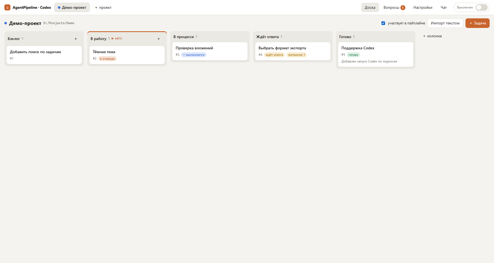
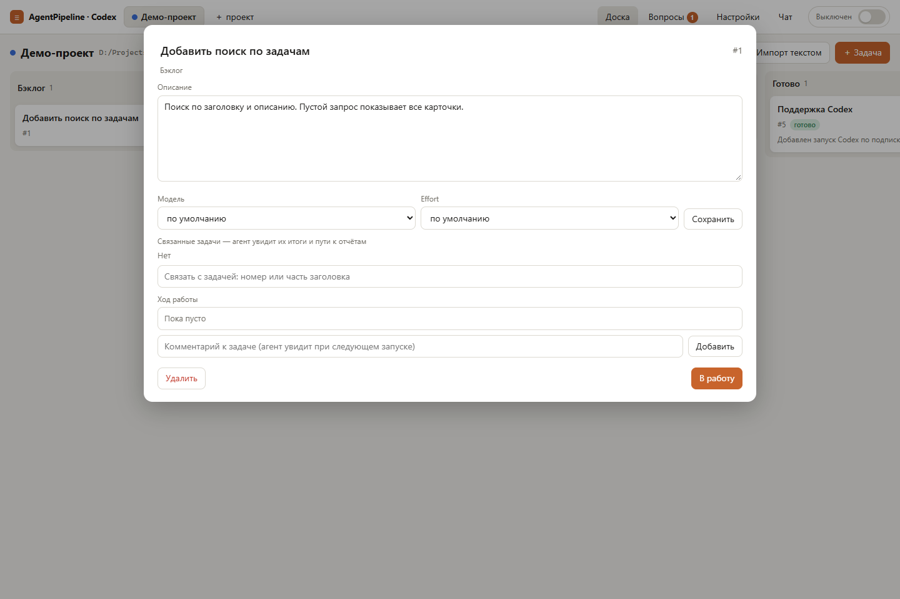
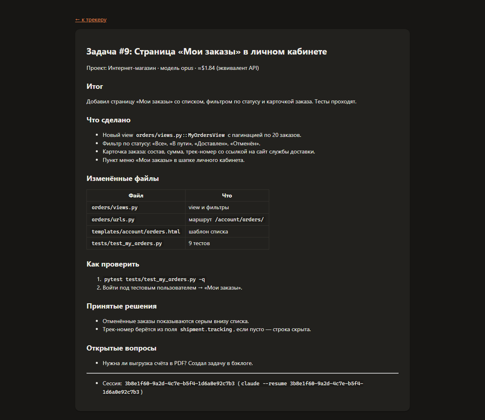
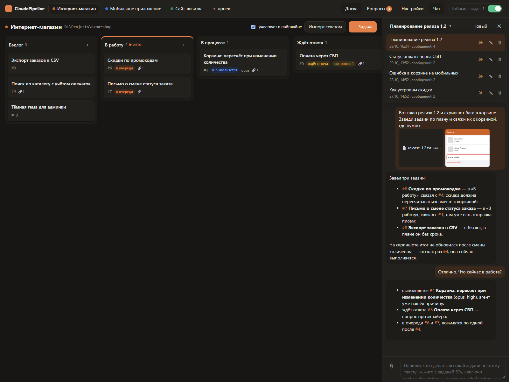
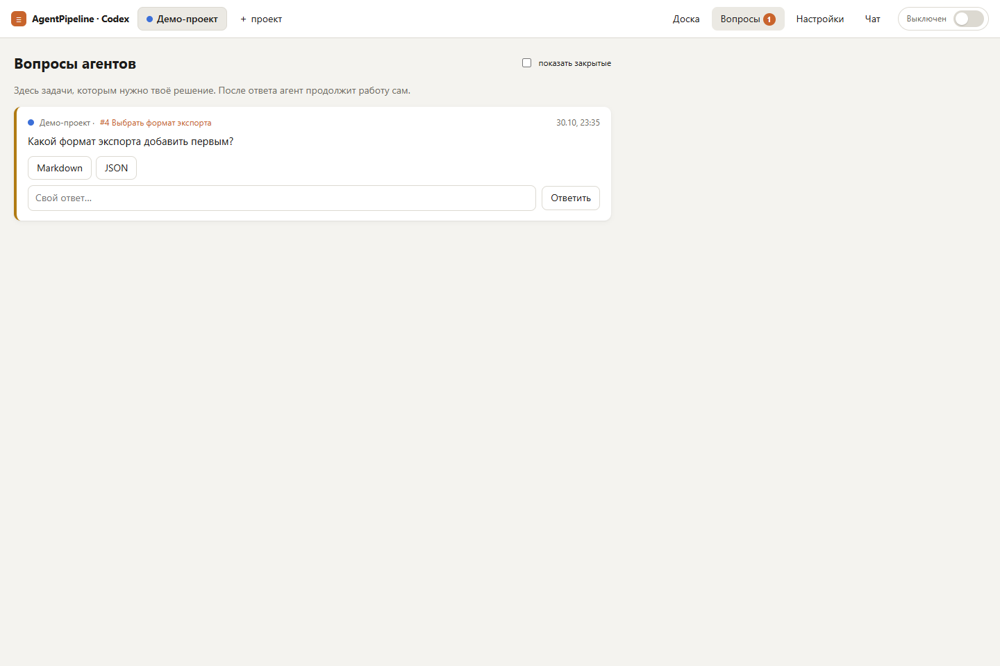
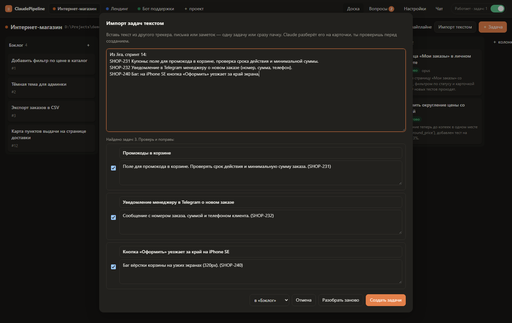

# ClaudePipeline

Личный канбан-трекер, задачи из которого выполняет Claude Code по подписке, без API-ключа.

Заводишь задачи на доске, переносишь в «В работу» и включаешь переключатель. Дальше трекер сам запускает на каждую задачу отдельную сессию `claude -p` в папке проекта. Агент отмечает прогресс, задаёт вопросы, если без тебя не обойтись, и в конце пишет отчёт. Всё работает локально: сервер на Python без внешних зависимостей, интерфейс в браузере.



## Возможности

- **Доска на каждый проект.** Колонки Бэклог → В работу → В процессе → Ждёт ответа → Готово, можно добавлять свои. Карточки перетаскиваются мышью.
- **Автоматическое выполнение.** Задачи из «В работу» запускаются сами, у каждой своя сессия, и контекст не смешивается. В одном проекте задачи идут по одной, а разные проекты работают параллельно (лимит задаётся в настройках).
- **Вопросы агентов.** Когда агенту нужно твоё решение, задача уходит в «Ждёт ответа», а вопрос появляется на странице «Вопросы». После ответа сессия продолжается с того же места.
- **Отчёты.** У готовой задачи есть краткий итог в карточке и подробный markdown-отчёт: что сделано, какие файлы изменены, как проверить, какие решения приняты.
- **Чат с Claude** на каждый проект. Он видит доску, заводит и двигает задачи, отвечает про статус, включает пайплайн. Можно прикладывать файлы и скриншоты.
- **Импорт текстом.** Вставляешь кусок из Jira, письма или заметок, Claude разбирает его на карточки, а ты проверяешь их перед созданием.
- **Лимиты подписки.** Если подписка упёрлась в лимит, пайплайн встаёт на паузу до сброса и потом продолжает сам.
- **Любую сессию можно продолжить вручную:** `claude --resume <id>` в папке проекта.

## Требования

- Windows 10/11.
- Python 3.10+ (должен вызываться как `python`).
- Установленный [Claude Code](https://docs.claude.com/en/docs/claude-code), в котором выполнен вход по подписке (Pro/Max): команда `claude` запускается из терминала и не просит войти. API-ключ не нужен.

Больше ничего ставить не надо: ни pip, ни npm.

## Установка и запуск

```
git clone https://github.com/makisima3/ClaudePipeline.git
cd ClaudePipeline
start.cmd
```

`start.cmd` запускает `python server\main.py` и открывает в браузере http://127.0.0.1:8765. При первом запуске создаётся пустая база `data/tracker.db`. Сервер слушает только `127.0.0.1`, снаружи он недоступен.

- Другой порт: `set PIPELINE_PORT=8800` перед `start.cmd`.
- Без автооткрытия браузера: `start.cmd --no-browser`.
- Остановить: Ctrl+C в окне сервера. Прерванные задачи продолжатся после следующего запуска, если пайплайн включён.
- Перезапустить: «Настройки» → «Перезапустить трекер». Подробнее — в разделе «Как устроено».

## Как пользоваться

1. **Создай проект.** «＋ проект» в шапке → название и папка, в которой Claude будет работать (кнопка «Обзор…» открывает выбор папки). Если в папке есть `CLAUDE.md`, агенты его подхватят.
2. **Заведи задачи** одним из способов:
   - вручную: «＋ Задача» или «＋» в колонке; можно указать модель и effort;
   - через чат («Чат» в шапке): «заведи задачи: …», «перенеси #5 в работу»;
   - импортом текстом («Импорт текстом» над доской).
3. **Перенеси задачи в «В работу»** (перетаскиванием или кнопкой «В работу» в карточке).
4. **Включи переключатель** в правом верхнем углу. Задачи начнут выполняться, а ход работы виден в карточке в реальном времени.
5. **Отвечай на вопросы.** Число открытых вопросов показано рядом с «Вопросы». Ответить можно там или в карточке задачи, вариантом или своим текстом.
6. **Смотри результаты.** Готовые задачи попадают в «Готово» с итогом. В карточке есть ссылка «подробный отчёт», кнопка «Сырой лог» и id сессии.
7. **Продолжай работу:**
   - вручную: `claude --resume <id сессии>` в папке проекта (полный id есть в подсказке у сессии в карточке и в конце отчёта);
   - через трекер: напиши комментарий и нажми «Продолжить / вернуть в работу». Агент продолжит ту же сессию, учитывая комментарий.

В «Настройках» задаются: что делать при выключении (доделать текущие или прервать сразу), сколько задач выполнять параллельно, режим разрешений, модели по умолчанию и общие указания всем агентам. В режиме разрешений, отличном от bypass, запросы прав тоже приходят в «Вопросы» с кнопками «Разрешить / Запретить».

### Карточка задачи



### Отчёт



### Чат



### Вопросы агентов



### Импорт текстом



Скриншоты сняты на демо-данных.

## Как устроено

- **Проекты.** У каждого проекта своя папка и своя доска. Claude работает в папке проекта.
- **Колонки:** Бэклог → **В работу** → В процессе → **Ждёт ответа** → Готово. Можно добавлять свои.
- **Переключатель** в шапке. Когда он включён, задачи из «В работу» выполняются: на каждую задачу запускается отдельная сессия `claude -p`, контекст у задач не смешивается. В одном проекте задачи идут по одной, параллельно — до N задач (N задаётся в настройках).
- **Выключение** (режим выбирается в настройках):
  - «доделать текущие» — начатые задачи завершаются, новые не берутся;
  - «прервать сразу» — процессы останавливаются, при следующем включении задачи продолжатся с того же места.
- **Вопросы.** Агент задаёт вопрос через `ask_user`, и задача уходит в «Ждёт ответа». Ответ даётся на странице «Вопросы» или в карточке, после этого сессия продолжается через `--resume`. Если режим разрешений не bypass, запросы прав тоже приходят сюда как «Разрешить / Запретить».
- **Отчёты.** При завершении в карточке появляется краткий итог и ссылка на подробный отчёт (`/report/<id>`, файл `data/reports/task-<id>.md`). Сырой лог лежит в `data/runs/task-<id>.jsonl`. Любую сессию можно продолжить вручную: `claude --resume <id>` в папке проекта.
- **Чат** справа — отдельная сессия Claude на каждый проект. Через MCP-инструменты трекера он создаёт и двигает задачи, отвечает про статус, включает пайплайн. В чат можно прикладывать файлы: скрепкой, перетаскиванием или скриншотом через Ctrl+V (до 20 МБ на файл, до 10 файлов и 100 МБ на сообщение). Файлы лежат в `data/uploads/<id проекта>/` и удаляются кнопкой «Новый».
- **Импорт текстом.** Вставляешь текст из любого трекера, Claude разбирает его на карточки, ты проверяешь перед созданием.
- **Лимиты.** Если подписка упрётся в лимит, пайплайн встанет на паузу до сброса и потом продолжит сам.
- **Перезапуск трекера.** Нужен, чтобы вступили в силу изменения в коде сервера. Запускается кнопкой «Перезапустить трекер» в настройках или самим агентом: если задача меняла код трекера, агент после отчёта вызывает инструмент `restart_tracker`. Перезапуск отложенный: трекер ждёт, пока доработают выполняющиеся задачи и ответ чата (включая агента, который его запросил), и новых задач до этого не берёт. Если ждать приходится дольше 10 минут, запуски прерываются и продолжаются после старта. Новый сервер стартует в своём свёрнутом окне консоли, старое окно закрывается. Открытые вкладки, пока сервер недоступен, показывают плашку «Трекер перезапускается…», потом перезагружаются сами. Журнал перезапусков — `data/restart.log`.
- **Обновление страницы.** Доска, шапка и чат обновляются сами по событиям сервера (SSE). Вкладок трекера можно открыть сколько угодно: соединение с сервером держит одна из них и раздаёт события остальным, так что лимит браузера на ~6 соединений к одному адресу не мешает. Если связь с сервером прерывалась, после переподключения страница перечитывает все данные. Кроме того, открытая вкладка сверяется с сервером раз в 20 секунд и при возврате на неё.

## Файлы

- `start.cmd` — запуск сервера.
- `server/main.py` — HTTP API и SSE.
- `server/pipeline.py` — оркестратор, чат, обработчики MCP, импорт.
- `server/runner.py` — запуск `claude -p` и разбор stream-json.
- `server/mcp_tracker.py` — MCP-сервер, через который агенты общаются с трекером.
- `server/db.py` — SQLite (`data/tracker.db`).
- `web/` — интерфейс на чистом HTML и JS.
- `docs/screenshots/` — скриншоты для этого README.
- `CLAUDE.md` — заметки для Claude Code, который дорабатывает сам трекер.
- `data/` — база, отчёты, логи запусков, журнал перезапусков и вложения чата. Создаётся при первом запуске и в git не попадает.
